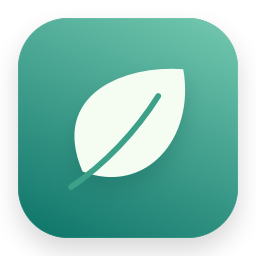
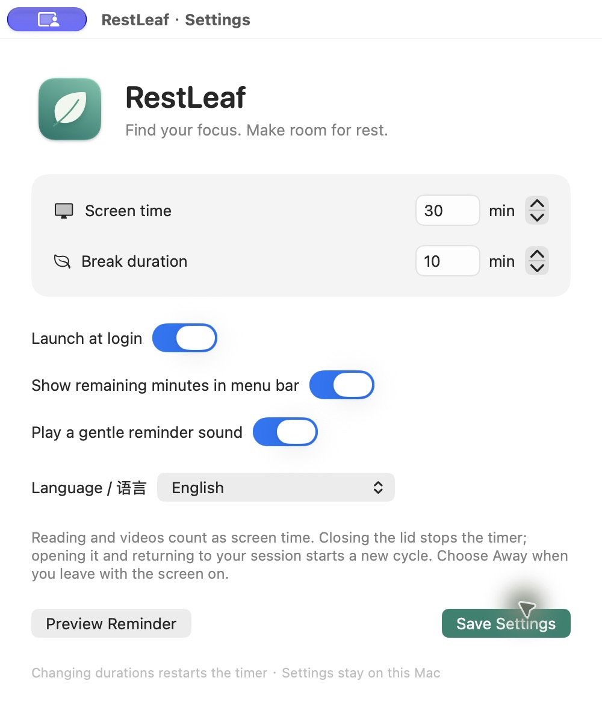

<p align="center"></p>
<h1 align="center">RestLeaf · 歇一会</h1>
<p align="center">A little space between you and your screen.</p>
<p align="center"><a href="README.zh-CN.md">简体中文</a> · <a href="https://github.com/nacoyuan/restleaf/releases/latest">Download</a> · <a href="https://github.com/nacoyuan/restleaf/issues">Feedback</a></p>

[](https://github.com/nacoyuan/restleaf/actions/workflows/checks.yml) 

RestLeaf is a native macOS menu bar app that reminds you to step away from your screen. It defaults to **40 minutes of screen time and a 10-minute break**, with both durations configurable.

Built by [Naco](https://github.com/nacoyuan), a product manager and independent vibe coder, from an everyday need: a reminder should be noticeable without taking focus away from ongoing work or AI tasks.

## Preview



The app includes English and Simplified Chinese. It follows the system language by default; choose a language in Settings to override it. Screenshots show an existing user's configuration; first-launch defaults are 40 / 10 minutes.

## What it does

- Lives in the menu bar, with no persistent Dock icon.
- Counts videos and reading as screen time, even without keyboard or mouse activity.
- Shows a clear banner that **does not take keyboard focus** and closes after **20 seconds**.
- Keeps an unacknowledged reminder in a break-due state; it does not silently count that as a completed break.
- Gives a 5-minute heads-up, then automatically shows a second-by-second countdown beside the menu bar icon. The normal break reminder appears at zero. Cycles shorter than 5 minutes skip this heads-up.
- **Away / Resume Timer** freezes the timer and preserves the remaining time, with no return-time schedule.
- **Start Over** starts a fresh work cycle.
- Closing the laptop lid stops the current timer. Opening it and returning to the unlocked, available session starts a full new cycle.
- Includes a break countdown, optional sound, remaining minutes in the menu bar, and optional launch at login.

## Download and install

Get the Apple Silicon ZIP from [Releases](https://github.com/nacoyuan/restleaf/releases/latest), extract it, and move the app to Applications before enabling launch at login.

**Early release:** current binaries are locally ad-hoc signed, not Developer ID signed or notarized. They have been tested on the maintainer's Apple Silicon Mac running macOS 27.0.1. Downloaded builds may be blocked by macOS Gatekeeper; this release does not provide the installation experience of a notarized app. You can inspect and build the source yourself.

The deployment target is macOS 13; that is a build setting, **not a claim of testing on every macOS version**. Intel builds and multi-display behavior have not been independently verified. See [ROADMAP.md](ROADMAP.md).

## Privacy and timer behavior

No account, network requests, analytics, camera, screen recording, or keystroke-content monitoring. Preferences stay on your Mac.

RestLeaf does not lock the screen, prevent sleep, simulate input, or control other apps. When you leave with the display still on, choose **Away**, then **Resume Timer** when you return. RestLeaf cannot detect whether you are actually looking at the screen.

Manual Away does not automatically expire. A lid-close/open cycle deliberately starts over instead of resuming the paused time. Ordinary lock/display-sleep events pause screen-time counting; a sufficiently long system absence can count as a natural break.

## Build

Requires an Apple Silicon Mac, Xcode Command Line Tools, and Python 3. Version 1.1 removes the source dependency on a macOS 27-only menu API; the full app has currently been built locally with Swift 6.4 / macOS 27 SDK. Older SDKs are not yet verified.

```sh
zsh build.sh
```

Output: `build/歇一会.app`. The script generates the original icon, compiles the native app, adds both language resources, ad-hoc signs the bundle, and runs the tests. The Finder name follows the system localization; the app language can be changed independently in Settings.

## Checks

```sh
build/歇一会.app/Contents/MacOS/RestLeaf --self-test
python3 scripts/check_localizations.py
```

There are **33 timer-state checks** plus checks for 50 bilingual strings and format placeholders. CI runs the timer checks and localization validation on macOS; GUI and hardware behavior still require manual testing. Changing only language, display, or sound preferences does not restart the timer. Background status updates are normally at most once per minute; only the final 5-minute work countdown refreshes every second.

The developer-only `--ui-test` mode uses 4-second work/rest cycles, real 20-second banner dismissal, and exits after 85 seconds. It can terminate another normal instance of this app and writes diagnostics next to the test bundle. Do not use it as your daily app.

## Contribute

Bug reports, translations, accessibility improvements, and focused fixes are welcome in **English or Chinese**. Start with [CONTRIBUTING.md](CONTRIBUTING.md). For sensitive security reports, see [SECURITY.md](SECURITY.md).

## License

[MIT](LICENSE) · Copyright © 2026 Naco. RestLeaf's icon is drawn from original paths in `DrawIcon.swift`.
