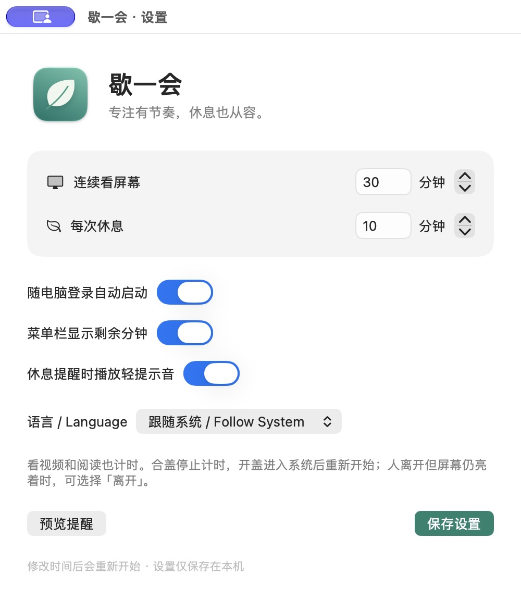

<p align="center"></p>
<h1 align="center">歇一会 · RestLeaf</h1>
<p align="center">给自己一点离开屏幕的时间。</p>
<p align="center"><a href="README.md">English</a> · <a href="https://github.com/nacoyuan/restleaf/releases/latest">下载应用</a> · <a href="https://github.com/nacoyuan/restleaf/issues">反馈问题</a></p>

[](https://github.com/nacoyuan/restleaf/actions/workflows/checks.yml) 

原生 macOS 菜单栏休息提醒工具，默认连续看屏幕 **40 分钟**、休息 **10 分钟**，均可自定义。

由产品经理、独立 vibe coder [Naco](https://github.com/nacoyuan) 从日常需求出发开发：提醒需要显眼，也应该让当前操作和 AI 任务安静地继续。

## 界面



支持简体中文与英文，默认跟随系统，也可以在设置中手动选择。截图使用现有用户配置，首次启动默认值为 40 / 10 分钟。

## 功能

- 常驻菜单栏，不长期占据 Dock。
- 看视频、阅读和没有键鼠操作时也计时。
- 提醒横幅不抢键盘焦点，**20 秒后自动收起**；没有确认时保留待休息状态，不擅自认定已休息。
- 距离休息还有 5 分钟时预提醒，菜单栏旁自动显示逐秒倒计时；归零时正式提醒休息。不足 5 分钟的短周期跳过预提醒。
- **离开 / 恢复计时**：离开时冻结计时，回来继续剩余时间，无需设定离开多久。
- **重新开始**：丢弃剩余时间，开始完整新一轮。
- 合盖停止当前计时，重新开盖并进入解锁、可用的系统后，从完整使用时长重新开始。
- 支持休息倒计时、提示音、菜单栏剩余分钟和随登录启动。

## 下载与安装

在 [Releases](https://github.com/nacoyuan/restleaf/releases/latest) 下载 Apple Silicon ZIP，解压后放进「应用程序」，再开启登录启动。

**当前属于早期版本：**应用使用本地临时签名，尚未进行 Developer ID 正式签名和 Apple 公证。已在维护者自己的 Apple Silicon Mac、macOS 27.0.1 上验证；下载到其他电脑后可能被 Gatekeeper 拦截，目前尚不具备已公证应用的顺畅安装体验。你可以审阅源码并自行构建。

最低部署目标是 macOS 13，但这不等于所有系统版本均已测试。Intel 构建和多显示器行为尚未独立验证，后续计划见 [ROADMAP.md](ROADMAP.md)。

## 隐私与计时规则

无需账号，不联网，没有统计追踪、摄像头、屏幕录制或键盘内容监听。设置只保存在本机。

应用不锁屏、不阻止睡眠、不模拟输入，也不控制其他软件。人离开但屏幕仍亮着时，点「离开」；回来点「恢复计时」。应用无法判断你是否仍在看屏幕。

手动离开不会自动结束。合盖再开盖的规则优先，进入系统后重新开始。普通锁屏或显示器关闭会暂停使用时间累计，系统不可用时间足够长时可视作一次自然休息。

## 从源码构建

需要 Apple Silicon Mac、Xcode 开发工具和 Python 3。1.1 版已去掉对 macOS 27 专有菜单 API 的源码依赖；完整应用目前使用 Swift 6.4 / macOS 27 SDK 构建验证，较早 SDK 尚未验证。

```sh
zsh build.sh
```

输出 `build/歇一会.app`。脚本生成原生图标、编译应用、加入中英文资源、进行本地临时签名并运行测试。Finder 名称跟随系统本地化，应用内部语言可单独切换。

## 检查

```sh
build/歇一会.app/Contents/MacOS/RestLeaf --self-test
python3 scripts/check_localizations.py
```

包含 **33 项计时逻辑检查**及双语资源、格式占位符检查。CI 验证核心逻辑与语言资源，界面和硬件行为仍需实机测试。仅修改语言、显示或声音偏好不会重置计时。正常后台最多每分钟刷新一次，只有最后 5 分钟的使用倒计时会每秒刷新。

开发专用的 `--ui-test` 使用 4 秒工作/休息周期，仍在真实 20 秒后收起横幅，并在 85 秒后退出。它可能结束同一应用的普通运行实例，并在测试包旁写入诊断文件，不用于日常运行。

## 参与

欢迎中文或英文的问题反馈、翻译、无障碍改进及小范围修复。见 [贡献指南](CONTRIBUTING.md) 和 [安全说明](SECURITY.md)。

## 许可证

[MIT](LICENSE) · Copyright © 2026 Naco。应用图标由 `DrawIcon.swift` 的原创路径绘制。
